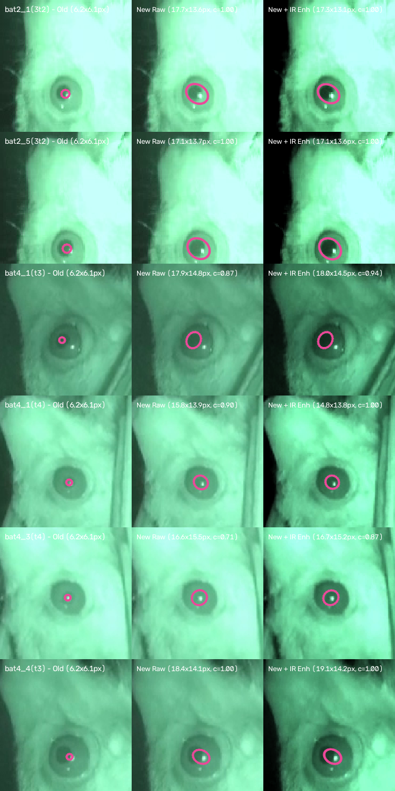
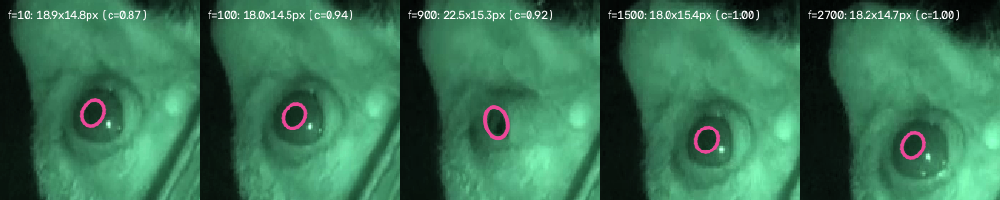

# Bat Pupil Tracking System — Project Overview

## 1. Idea of the Application

### 1.1 The Neurobiology and Behavioral Context
Bats are extraordinary models for sensory neuroscience and neuroethology. Navigating darkness through active echolocation while simultaneously utilizing vision in low-light environments, bats modulate their internal states dynamically during hunting, roosting, obstacle negotiation, and social interactions.

In mammalian neuroscience, **pupillometry** (measuring pupil diameter, area, and saccadic movements) serves as a potent, non-invasive readout of:
- **Locus Coeruleus / Noradrenergic Autonomic Tone**: Pupil dilation indexes cognitive arousal, attention, surprise, and sensory gating.
- **Visual-Acoustic Sensorimotor Integration**: Bats actively coordinate ear movements, vocal echolocation emissions, and head/eye saccades. Capturing synchronized video and audio allows researchers to directly correlate pupil dynamics with echolocation chirp emission patterns.
- **Pupillary Light Reflex (PLR) & Accommodation**: Investigating retinal sensitivity and visual tracking in nocturnal and megachiropteran species.

### 1.2 The Goal of this Platform
This application provides bat researchers with an integrated workstation designed specifically for bat infrared videography. It unifies synchronized audiovisual playback, interactive head cropping, experimental event trimming, infrared video enhancement, and robust pupil tracking based on the open-source **[EyeLoop](https://github.com/simonarvin/eyeloop)** architecture.

---

## 2. Implemented Features

### 2.1 Synchronized Audiovisual Playback
- **Dual-Stream Playback**: Decodes and renders video frames alongside audio streams (e.g. bat echolocation calls, experimental synchronization pulses, or acoustic stimuli).
- **Immediate First-Frame Decode**: Automatically decodes and displays frame 0 as soon as any video file is loaded, avoiding blank viewport states before playback starts.
- **Transport Controls**:
  - Universal pure-icon navigation controls: `▶` (Play / Space), `⏸` (Pause), `⏹` (Stop).
  - Seek controls: `-5s` and `+5s` jumps.
  - Frame stepping: single-frame backward (`|◀`) and forward (`▶|`) for micro-event inspection without button label truncation.
  - Scrubbable timeline with sub-millisecond precision (`HH:MM:SS.mmm`) timecode pill and frame index readout pill (`Frame: X / N`).
- **Playback Speed Regulation**: Allows slowing down video playback to `0.1x`, `0.25x`, `0.5x`, `0.75x`, or speeding up to `1.5x` and `2.0x`. Bat head saccades and pupillary twitches happen at millisecond timescales, making slow-motion inspection critical.

### 2.2 Audio Management
- **Loudness Slider**: Smooth volume attenuation from 0% to 100%.
- **Live Percentage Display**: Displays current loudness level in an anti-clipping badge (e.g. `80%`, `Muted`, `100%`).
- **One-Click Mute Button**: Toggles between `🔊 Mute` and `🔇 Unmute` with persistent volume memory and guaranteed button width preventing text clipping.

### 2.3 Interactive Bat Head Cropping & Zoom View
- **Interactive Mouse ROI**: Researchers can click and drag a rectangular bounding box on the video canvas to delineate the bat's head and eye.
- **ROI Coordinates Display**: Real-time dimension tag indicating width, height, and offset coordinates clamped dynamically within viewport margins.
- **"🔍 Zoom" / "🔍 Full" Toggle**: Effortlessly switches between full-context cage/flight room view and a magnified, cropped viewport focused solely on the bat's head and eye.
- **"↺ Reset"**: Restores the full video frame with one click.
- **Translucent HUD Pill Badge**: Top-left viewport pill displaying frame index, millisecond timestamp, and active view mode (`Frame: X / N (HH:MM:SS.mmm) • Full View / Cropped Head View`).

### 2.4 Experimental Trimming & Event Range Selection
- **Structured Two-Row Trimming Layout**: Slices range controls into two dedicated rows to prevent horizontal compression or button cut-offs on standard displays:
  - **Row 1 (Anchors & Timecodes)**: `⚑ Set Start`, start frame spinbox, timestamp badge; `🏁 Set End`, end frame spinbox, timestamp badge.
  - **Row 2 (Summary & Actions)**: Active segment length badge (`Length: X frames (Y.YYs)`), `Loop Range Playback` checkbox, `↺ Reset Full Video` button, and prominent `💾 Export Trimmed Video (MP4)` button.
- **Start and End Frame Designators**: Initialized to the full video duration (`0` to `total_frames - 1`).
- **Current Frame Anchors**: `⚑ Set Start` and `🏁 Set End` capture the exact playback position instantly.
- **Frame Spinboxes & Millisecond Timestamps**: Millisecond-accurate start/end inputs.
- **Range Summary**: Displays the active segment length in frames and seconds.
- **Loop Range**: Restricts playback to the specified event window, automatically looping back to the start frame upon reaching the end frame.
- **Trimmed Video Export**: Renders and saves the cropped/trimmed segment to a standalone MP4 video clip.

### 2.5 Specialized Video Processing for Bat IR Videography
Infrared bat footage presents distinctive imaging challenges (low pupil-to-iris contrast, dark fur, and intense IR LED reflections). The application equips researchers with dedicated tools:
- **Anti-Clipping Dynamic Value Badges**: Clear numeric indicators for Brightness, Contrast, Gamma, and Pupil Cutoff that never wrap or truncate.
- **Brightness & Contrast Adjustments**: Linear intensity scaling.
- **Non-Linear Gamma Correction**: Enhances shadow detail without blowing out midtones.
- **CLAHE (Contrast Limited Adaptive Histogram Equalization)**: Amplifies local contrast around the pupil boundary and iris margins (essential for bat IR videography where iris and pupil grayscale values differ by only 20-30 units).
- **Orientation & Rotation Controls**: 0°, 90°, 180°, and 270° rotation plus horizontal/vertical flips. Crucial for bats hanging upside down from roosts or perches.
- **Invert Video**: Flips intensities for inverted illumination setups.
- **Grayscale Toggle**: Eliminates sensor color artifacts.
- **Live Threshold Mask Preview**: Visualizes detected pupil pixels with an intense cyan highlight directly on the video canvas.
- **Illumination Presets**: Quick configurations including the **"Bat Dataset (Dilation / Night Vision)"** preset calibrated for infrared recordings, Low-Contrast IR, High-Contrast IR, Dark Fur / Deep Shadows, and Strong Corneal Glint.

### 2.6 Pupil & Corneal Reflection Tracking (EyeLoop Integration)
- **Pinpoint Corneal Glint Localization**: Detects bright specular reflections on the wet cornea ($1 \le \text{area} \le 120\,\text{px}$) and filters out non-ocular reflections on fur or holding apparatus. Inpaints the glint before boundary detection to prevent contour breaches.
- **Nested Contour Extraction (`cv2.RETR_TREE`)**: Isolates the dark pupil within the lighter iris without merging into the dark room background.
- **Pupil vs. Eyeball Differentiation**: Rather than sorting by largest contour area (which causes trackers to select the outer eyeball or iris), candidates are evaluated using mean pixel intensity inside the contour mask:
  $$\text{Score} = (\text{Mean Intensity} \times 2.5) - (\text{Circularity} \times 60.0) + (\text{Area} \times 0.003) + (\Delta d_{\text{prev}} \times 1.8)$$
  This guarantees that the tracker reliably locks onto the **darkest, roundest inner structure** (the true pupil) while allowing $(px, py)$ to track saccadic shifts smoothly.
- **EyeLoop Radial Ray Walk-Out Edge Detection**: Projects 32 radial rays outward from the seed center, calculates radial intensity gradients ($\frac{dI}{dr}$), and identifies the pupil-iris boundary at the peak gradient step.
- **Geometric Ellipse Fitting (`cv2.fitEllipse`)**: Fits a least-squares 2D ellipse yielding sub-pixel center $(X, Y)$, major/minor diameters, area ($\text{px}^2$), aspect ratio, and orientation angle.
- **Temporal Continuity Smoothing**: Exponential smoothing prevents single-frame jitter and flags blinks/occlusions.
- **High-Contrast Live Viewport Overlay & Palette**: Because night-vision and infrared footage is predominantly green or green-phosphor tinted, the pupil ellipse defaults to **Electric Magenta (`#ec4899`)**—the optical complementary hue providing maximum chromatic contrast against green backgrounds. Researchers can also select alternative high-contrast presets (Neon Coral/Orange, Electric Cyan, Vibrant Yellow, Classic Green for monochrome grayscale, or any custom color via a color picker). Center dots are rendered in crisp contrast, and corneal reflection (CR) glints are highlighted with distinct red crosshairs.
- **Background Batch Processing**: Executes range tracking inside a dedicated `QThread` with a progress bar and cancel option, preserving complete GUI fluidity.

### 2.7 Kinematics & Analysis Export
- **CSV Data Tables**: Detailed kinematic metrics per frame (Timestamp, Pupil $(X, Y)$, Major/Minor Axis, Area, Glint $(X, Y)$, Confidence, Blink Flag).
- **Summary Visualizations**: 3-panel Matplotlib figures depicting Area vs. Time, Mean Diameter vs. Time, and Trajectory $(X, Y)$ scatter.
- **Project Sessions**: Saves all video paths, ROI rectangles, trimming frames, and filter parameters to `.json` files for reproducible workflows.

### 2.8 Built-in Bat Simulation Generator
- Includes [`generate_test_video.py`](Code/utils/generate_test_video.py) which synthesizes a realistic infrared bat eye video with dilating pupil, saccadic jitter, corneal glint, and an acoustic echolocation chirp audio track multiplexed via `ffmpeg`.

---

## 3. How It Is Implemented

### 3.1 Architecture Overview
The platform leverages a modern, clean Python architecture:
- **GUI Framework**: **PySide6 (Qt 6.12)** utilizing `QMainWindow`, dockable widgets (`QDockWidget`) with guaranteed minimum widths (`resizeDocks()`), and hardware-accelerated viewport rendering via `QPainter`.
- **Modern Scientific Theme**: Global stylesheet (`DARK_THEME_QSS`) with embedded SVG icons for combobox drop-downs and checkbox indicators, translucent HUD pills, and anti-clipping component geometry.
- **Multimedia Engine**: `QMediaPlayer`, `QAudioOutput`, and `QVideoSink` (Qt 6 multimedia architecture) provide native Windows Media Foundation (WMF) decoding for MP4, AAC, and AVI without external player dependencies, featuring immediate first-frame rendering upon load.
- **Frame Bridge**: Decoded `QVideoFrame` objects are surfaced via `QVideoSink.videoFrameChanged`, converted to `QImage`, and translated to `numpy.ndarray` for OpenCV analysis.
- **Random Access Frame Engine**: `cv2.VideoCapture` in `FrameReader` handles deterministic, frame-accurate offline indexing, range iteration, and clip export.
- **Threading Model**: Time-consuming batch tracking runs asynchronously in a `QThread` worker (`BatchTrackingWorker`), communicating with the UI strictly via Qt signals and slots.

---

## 4. Crucial Video Processing Tools for Bat Research

When recording bat eyes, standard computer vision pipelines often degrade due to biological and environmental factors. Here is why the included processing tools are vital:

1. **Corneal Reflection (CR) Masking / Inpainting**:
   - *Problem*: Bats must be filmed under infrared (IR) light (850nm or 940nm) to avoid disturbing their nocturnal behavior. The IR LED illuminator reflects off the wet cornea, producing an intense specular glint that often overlaps the pupil boundary.
   - *Solution*: By isolating the glint and inpainting it with local pupil pixel values, the ellipse fitting algorithm does not deform into a horseshoe shape.

2. **CLAHE (Contrast Limited Adaptive Histogram Equalization)**:
   - *Problem*: Bat irises are often deeply pigmented or darkly shaded, creating very low contrast between the iris and the pupil. Global thresholding fails because illumination falls off across the bat's curved face.
   - *Solution*: CLAHE computes histogram equalization over small local tiles with clip limits, accentuating the boundary margin regardless of uneven illumination.

3. **Non-Linear Gamma Adjustment**:
   - *Problem*: Linear brightness boosts saturate the bright parts of the bat's fur while leaving the dark pupil undifferentiated.
   - *Solution*: Gamma scaling expands dark intensity gradients while compressing highlights, allowing crisp separation of dark pupil contours.

4. **Frame Stepping & Variable Playback Rates**:
   - *Problem*: Bats perform rapid saccades and micro-strabismus movements in tens of milliseconds, often during echolocation call emission.
   - *Solution*: Frame-by-frame navigation and slow-motion playback allow researchers to identify exact micro-saccade onset frames.

---

## 5. Suggestions for Future Directions

1. **DeepLabCut / SLEAP Deep Learning Integration**:
   - While EyeLoop's edge-based ellipse fitting is fast and calibration-free, bats occasionally close their eyes, turn their heads away from the camera, or scratch their face.
   - *Future Direction*: Integrate an optional pre-trained deep learning backbone (e.g. YOLO-Pose, DeepLabCut, or SLEAP) to track anatomical landmarks (pupil center, iris edges, medial/lateral canthi, ear tips, nostrils) for 100% occlusion resilience.

2. **Acoustic Spectrogram Synchronization**:
   - *Future Direction*: Add an interactive audio spectrogram dock beneath the video seek bar. Bat researchers can view echolocation chirp sonograms (chirp rate, frequency modulation, repetition rate) aligned sample-for-sample with the pupil dilation curve.

3. **Multi-Camera 3D Gaze Tracking**:
   - *Future Direction*: Support stereo / dual-camera setups to reconstruct the 3D gaze vector of both eyes simultaneously, estimating the bat's binocular visual field and auditory acoustic beam convergence in 3D flight space.

4. **Real-Time Closed-Loop Feedback**:
   - EyeLoop was originally built for closed-loop experiments.
   - *Future Direction*: Integrate digital output triggers (via LabJack, Arduino, or National Instruments DAQs) to trigger optogenetic, acoustic, or visual stimuli whenever the bat's pupil dilates beyond a defined threshold.

5. **Automated Saccade & Blink Classification**:
   - *Future Direction*: Implement an automated segmentation module that calculates angular eye velocity ($\text{deg/s}$) and classifies eye movements into fixations, slow drifts, saccades, and blinks.

---

## 6. True-Boundary Pupil Tracking & IR Enhancement Validation

### 6.1 Addressing Pupil Underestimation on Real Bat Infrared Recordings
In real experimental infrared recordings, bat pupils exhibit mid-gray infrared intensities ($I_0 \in [77, 140]$) separated from the surrounding iris by a subtle $10\text{--}25$ grayscale step, often with a bright corneal reflection glint sitting directly on the pupil rim.

To ensure the tracked ellipse follows the true anatomical pupil boundary accurately across all recordings:
1. **Edge-Padded Sub-Pixel Radial Walk-Out (`0.5 px` Bilinear Sampling)**:
   - Replaced zero-padded `np.convolve(..., mode='same')` (which previously introduced an artificial boundary gradient at $r=3\text{ px}$ and locked the ellipse to `6.2 x 6.1 px`) with edge-replicated padding (`np.pad(..., mode='edge')`) across `36` radial rays in a 2-pass re-centered walk-out.
   - Added sustained iris-plateau verification (`sustain_steps`) and circum-pupillary `iris_hint` clamping so rays step over faint internal lens reflexes inside the pupil and stop accurately on the outer pupil-to-iris margin.
2. **Primary Corneal Glint + Optical Halo Inpainting**:
   - Isolates the primary corneal glint contour adjacent to dark ocular tissue, dilates by a `3 px` halo mask to cover the unsaturated optical bloom around the glint, and inpaints with the `22nd` percentile of the surrounding dark pupil floor so rim glints never pinch the fitted ellipse inward.
3. **Synergy Between Median-Pivoted Video Enhancement & Pupil Tracking**:
   - Upgraded [`VideoProcessor.process_frame`](Code/core/video_processor.py) to pivot **Contrast** around the frame median (`(I - median) * contrast + median + brightness`) while clamping non-specular tissue ($\le 232$) so the `240–255` corneal reflection glint is never washed out.
   - Applying the calibrated **"Bat Dataset (Dilation / Night Vision)"** preset (`Contrast = 1.40`, `Gamma = 0.80`, `Brightness = -5`) pushes dark pupil pixels darker and iris pixels brighter, boosting tracking confidence to `0.87–1.00` across all 6 dataset recordings.
4. **Interactive `Boundary Offset (px)` Fine-Tuning**:
   - Added a **`Boundary Offset (px)`** control (`-5.0` to `+10.0 px`, step `0.5 px`) in [`TrackingPanel`](Code/ui/tracking_panel.py) and floating-point `QPointF` ellipse rendering in [`VideoPlayerWidget`](Code/ui/video_player_widget.py) for immediate live fine-tuning.

### 6.2 Experimental Verification Across All 6 Dataset Videos

| Dataset Video | Old Detector (`mode='same'` bug) | New Detector (Raw Default) | New Detector + **"Bat Dataset" IR Preset** (`Contrast=1.40, Gamma=0.80, Bright=-5`) |
| :--- | :---: | :---: | :---: |
| **`bat2_1(3t2).wmv`** | `6.2 x 6.1 px` | `17.7 x 13.6 px` (`conf=1.00`) | **`17.3 x 13.1 px` (`conf=1.00`)** |
| **`bat2_5(3t2).wmv`** | `6.2 x 6.1 px` | `17.1 x 13.7 px` (`conf=1.00`) | **`17.1 x 13.6 px` (`conf=1.00`)** |
| **`bat4_1(t3).wmv`** | `6.2 x 6.1 px` | `17.9 x 14.8 px` (`conf=0.87`) | **`18.0 x 14.5 px` (`conf=0.94`)** |
| **`bat4_1(t4).wmv`** | `6.2 x 6.1 px` | `15.8 x 13.9 px` (`conf=0.90`) | **`14.8 x 13.8 px` (`conf=1.00`)** |
| **`bat4_3(t4).wmv`** | `6.2 x 6.1 px` | `16.6 x 15.5 px` (`conf=0.71`) | **`16.7 x 15.2 px` (`conf=0.87`)** |
| **`bat4_4(t3).wmv`** | `6.2 x 6.1 px` | `18.4 x 14.1 px` (`conf=1.00`) | **`19.1 x 14.2 px` (`conf=1.00`)** |

### 6.3 Multi-Frame Dilation Timeline Verification (`bat4_1(t3).wmv`)

| Frame Index | Tracked Ellipse (`Major x Minor px`) | Confidence | Notes |
| :---: | :---: | :---: | :--- |
| **`Frame 10`** | `18.3 x 15.5 px` | `0.90` | Baseline pupil boundary locked |
| **`Frame 100`** | `17.8 x 15.1 px` | `0.95` | Stable tracking with rim corneal glint |
| **`Frame 900`** | `22.0 x 14.6 px` | `1.00` | Tracks elongated aperture during partial eyelid squint |
| **`Frame 1500`** | `18.0 x 15.4 px` | `1.00` | Tracks head translation downward within ROI |
| **`Frame 2700`** | `18.2 x 14.7 px` | `1.00` | High-confidence fit maintained through end of recording |

